# ResearchX

**An evidence-first research assistant for machine-learning literature.** Ask a question about published experiments and
ResearchX answers from a curated corpus of papers, with every claim tied to a verbatim quote from its source. When the
evidence is missing it says so instead of guessing, and when sources disagree it shows both. Eight analyses help
researchers compare papers, investigate discrepancies, rebuild experimental recipes and decide what to test next.

<p align="center">
  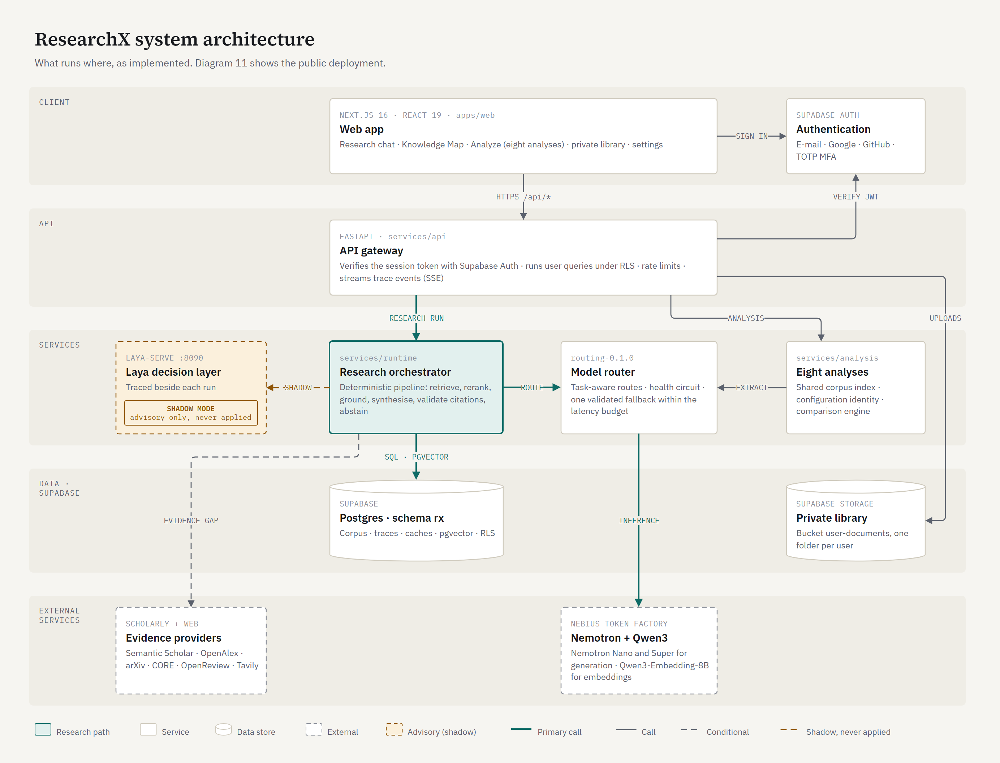
</p>

## Try it

**Live demo:** _the public URL is added here once the deployment is verified._

A shared account is available for judges and reviewers:

| | |
|---|---|
| E-mail | `researchx.judge@example.com` |
| Password | `Judge-y-eIoSavnrZp-2026` |

> [!WARNING]
> **This is a shared account.** Everyone who reads this page can sign in with it. **Do not upload private or sensitive
> documents to its private library:** anything uploaded there is visible to every other person using the account and
> may be deleted at any time. To try the private library with your own documents, sign up with your own e-mail address.

A good first question: *"What learning rate and batch size were used to train HRNetV2 + OCR on ADE20K?"* Then open
**Research Trace** and **Knowledge Map** on the answer. The suggested path through the product:

<p align="center">
  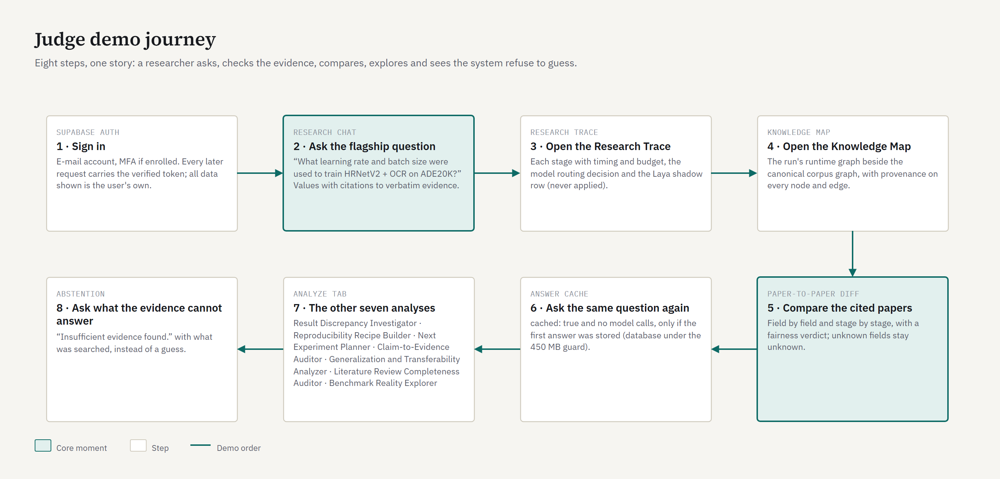
</p>

## What it does

- **Cited answers.** Hybrid retrieval (BM25 + pgvector) and an LLM reranker find passages; NVIDIA Nemotron models
  synthesise an answer whose every claim must quote its source verbatim, or the claim is removed.
- **Field-level grounding.** Questions about hyperparameters or scores are answered from validated values: each value
  needs a verbatim span and matching evaluation conditions (dataset, split, protocol, metric definition, stage).
- **Contradictions and abstention.** Recorded conflicts between sources are reported as `CONFLICTING`; when the
  evidence is insufficient the answer is `ABSTAINED` with *"Insufficient evidence found."* and what was searched.
- **Research Trace.** Every stage of every run (34 step types) is streamed live and stored per user: timing, budget,
  the model routing decision, cache hits and why anything was skipped.
- **Knowledge Map.** The shared, reviewed corpus graph beside the per-run runtime graph, with provenance on every node
  and edge. External sources can be proposed for review; private documents never can.
- **Private library.** Each user's uploaded documents are searched only for that user, under row-level security.

## Architecture

ResearchX has two halves. An **offline dataset pipeline** builds a frozen, validated corpus release from public
scholarly sources; the **online system** answers questions over that release, reaching outside it only when the corpus
evidence is insufficient.

**Request path.** The browser talks only to the Next.js app. Every page sits behind an auth gate (`apps/web/proxy.ts`
validates the Supabase session on each load), and `/api/*` is rewritten on the server to the FastAPI backend, so no
backend origin, database URL or provider key ever reaches the browser. The API verifies the bearer token with Supabase
Auth, applies per-user rate limits and hands a question to the research orchestrator, which streams each stage back
over server-sent events while it runs. Analyses go through the same API to `services/analysis`. Every generative model
call goes through the model gateway and its routing policy, and every statement on user data runs as the user under
PostgreSQL row-level security.

**Deterministic where it can be.** Models are used for what needs language understanding: reranking, synthesis and
extraction. Deciding what counts as evidence, whether a quote supports a claim, whether two experiments are comparable,
which model to call and whether to abstain is plain code, versioned and traced.

| Part | Responsibility |
|---|---|
| `apps/web` | Next.js 16 app: research chat, Knowledge Map (Cytoscape.js), Analyze, private library, settings; auth gate in `proxy.ts`; `/api/*` rewrite and Content-Security-Policy in `next.config.ts` |
| `services/api` | FastAPI app: authentication, rate limits, research runs (JSON or SSE), conversations, documents, Knowledge Map, analyses, metrics |
| `services/auth` | Bearer-token verification with Supabase Auth (accepted for at most 30 s) and the claims used to run SQL as the user |
| `services/runtime` | Research orchestrator, external providers and the source gate, arXiv full-text reader, private documents, in-process caches, Research Trace |
| `services/retrieval` | BM25, hybrid fusion (RRF) and LLM reranking; scholarly source clients; the retrieval scope that keeps private documents per user |
| `services/evidence` | Field-level grounding: request parsing, verbatim-span checks, normalisation of evaluation conditions |
| `services/model_gateway` | Nebius client with model-catalog resolution, retries and a health circuit; routing policy `routing-0.1.0`; schema validation of model outputs |
| `services/analysis` | The eight analyses, field facts, configuration identity, request-time full-text reading, runtime papers |
| `services/comparison` | Field-by-field comparison engine, conflicts, comparison candidates, study links |
| `services/graph` | Canonical Knowledge Map and the per-run runtime graph |
| `services/canonicalization` | Normalisation of titles, DOIs, arXiv ids and entity names; canonical entity ids |
| `services/extraction`, `services/datasets` | Dataset pipeline: parsing, rule-based and model-based experiment extraction, schemas, validation, releases |
| `services/laya` | Client of the Laya decision service (shadow mode) |
| `services/storage` | PostgreSQL connections |
| `config/` | `runtime.yaml` (retrieval, evidence, caches, budgets, Laya), `models.yaml` (model routes), `pipeline.yaml` and `domain.yaml` (dataset pipeline) |
| `supabase/migrations` | Schema `rx`, row-level-security policies, trace-step whitelist, private storage bucket |
| `scripts/` | Dataset pipeline, database loading, embeddings and BM25 build, evaluations, local start script |

### Data model

Everything lives in one Supabase project. Corpus tables are shared and read only by the backend; user-owned tables carry
owner-only row-level-security policies; original uploaded files sit in a private Storage bucket.

<p align="center">
  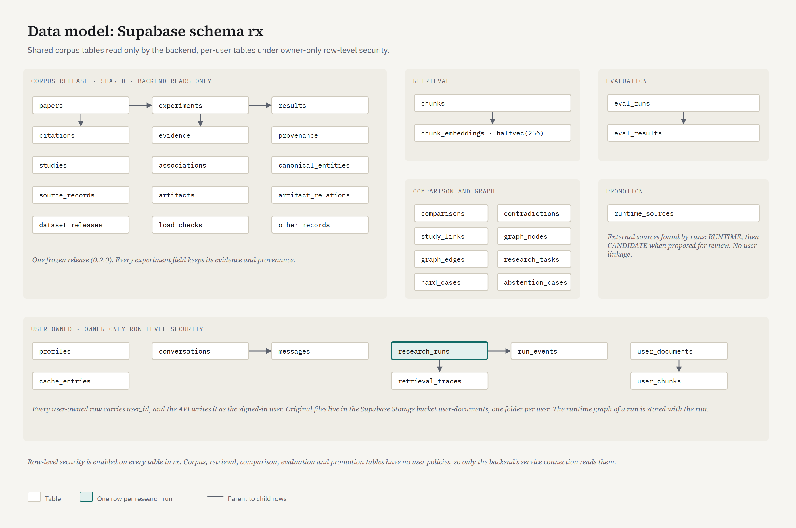
</p>

### Dataset pipeline

The corpus is built offline by `scripts/data/run_pipeline.py`: discovery from OpenAlex and arXiv, enrichment from
Semantic Scholar, arXiv and Papers with Code, full-text parsing, experiment and evidence extraction, comparison and
contradiction building, validation, leakage and licence checks, and a frozen release that is loaded into Supabase,
embedded and indexed.

<p align="center">
  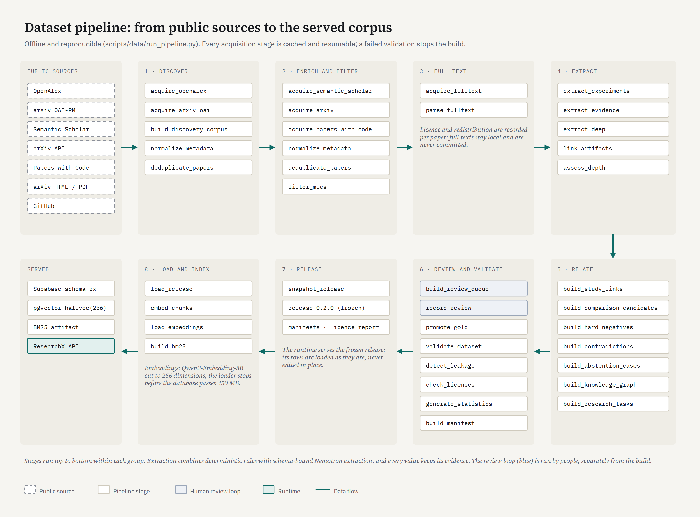
</p>

## How a question is answered

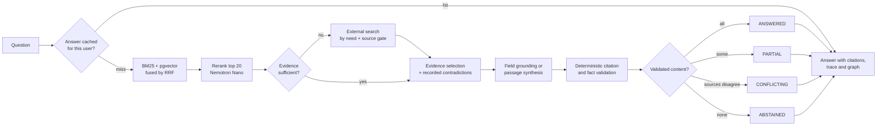

Each step below is a row in the Research Trace:

<p align="center">
  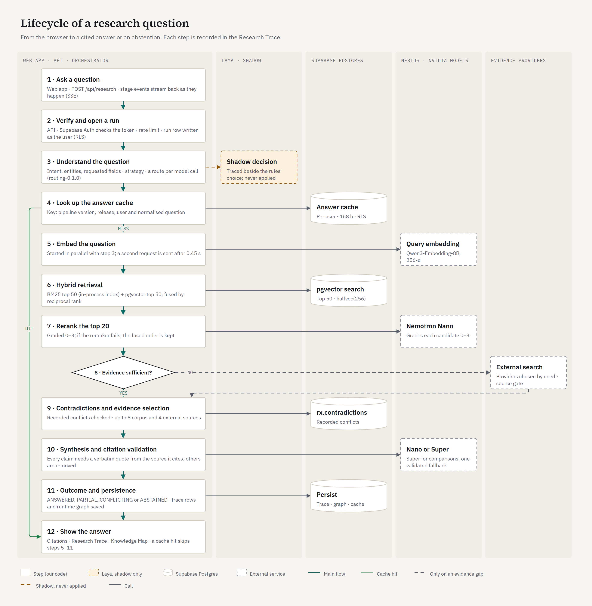
</p>

## Citations, provenance, conflicts and abstention

<p align="center">
  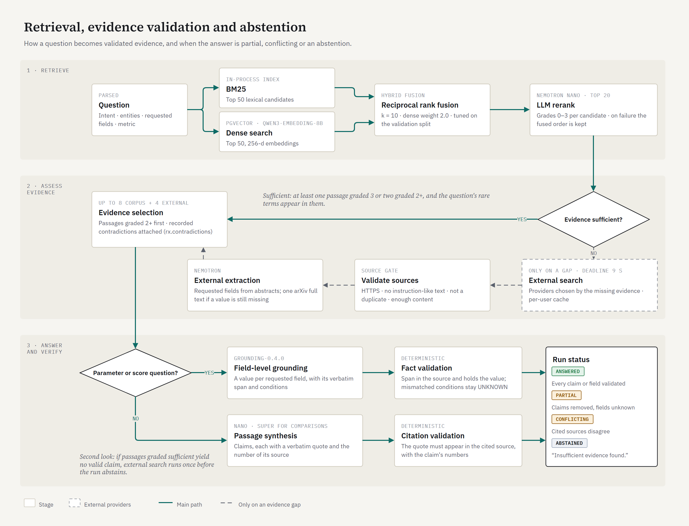
</p>

- A claim survives only if its quote appears verbatim in the source it cites and contains the claim's numbers
  (deterministic check, no LLM judge). The answer is rebuilt from the surviving claims.
- Field values carry their evidence and a status: `REPORTED`, `DERIVED` (with the rule that derived it), `CONFLICTING`
  or `UNKNOWN`. Unknown fields stay unknown; nothing is filled from defaults or similarity.
- Training settings keep their stage (pre-training, fine-tuning, evaluation): a pre-training learning rate is never
  compared with a fine-tuning one.
- External text passes a source gate before use: HTTPS only, instruction-like text rejected, duplicates dropped.
- Model routing never overrides an abstention, and Laya never decides what evidence exists.

## The eight analyses

| Analysis | What it answers |
|---|---|
| **Paper-to-Paper Diff** | How do two to four papers differ, field by field and training stage by training stage, and is the comparison fair? |
| **Result Discrepancy Investigator** | Why do two similar experiments report different results: verified differences versus what is simply not stated? |
| **Reproducibility Recipe Builder** | What exactly would I need to reproduce this experiment? Unstated settings stay `UNKNOWN`, never defaulted. |
| **Next Experiment Planner** | Which experiment (reproduce, ablate, transfer) would most reduce the uncertainty around a result? |
| **Claim-to-Evidence Auditor** | Do the corpus records support a stated comparison, reported value or training setting? |
| **Generalization and Transferability Analyzer** | Where else was a model evaluated, and which conditions (pre-training data, adaptation) changed? |
| **Literature Review Completeness Auditor** | What does a question or draft review cover, and what does the corpus suggest it leaves out? |
| **Benchmark Reality Explorer** | Every reported result for a benchmark and metric, classified `COMPARABLE`, `CONDITIONALLY_COMPARABLE`, `INCOMPATIBLE` or `UNKNOWN`. |

All eight read the same validated records, field facts, configuration identity and comparison engine. Paper-to-Paper
Diff and Benchmark Reality Explorer can also read papers outside the corpus at request time (arXiv full text or
abstract); those records are marked runtime and unreviewed, and nothing is written to the corpus.

<p align="center">
  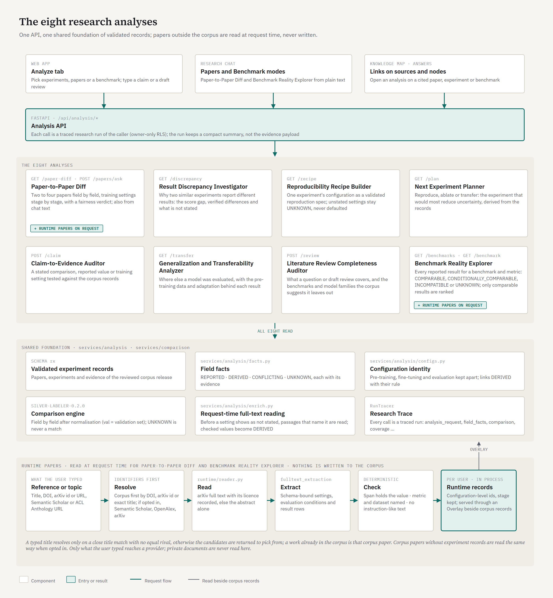
</p>

## Knowledge Map: canonical and runtime graphs

The shared graph comes from the reviewed corpus release; each research run also builds its own runtime graph from the
evidence it used. Identity merges only on identifiers (DOI, arXiv id, corpus id, canonical entity key); a matching title
alone never merges nodes. Promoting an external source to the shared corpus is an explicit, reviewed step.

<p align="center">
  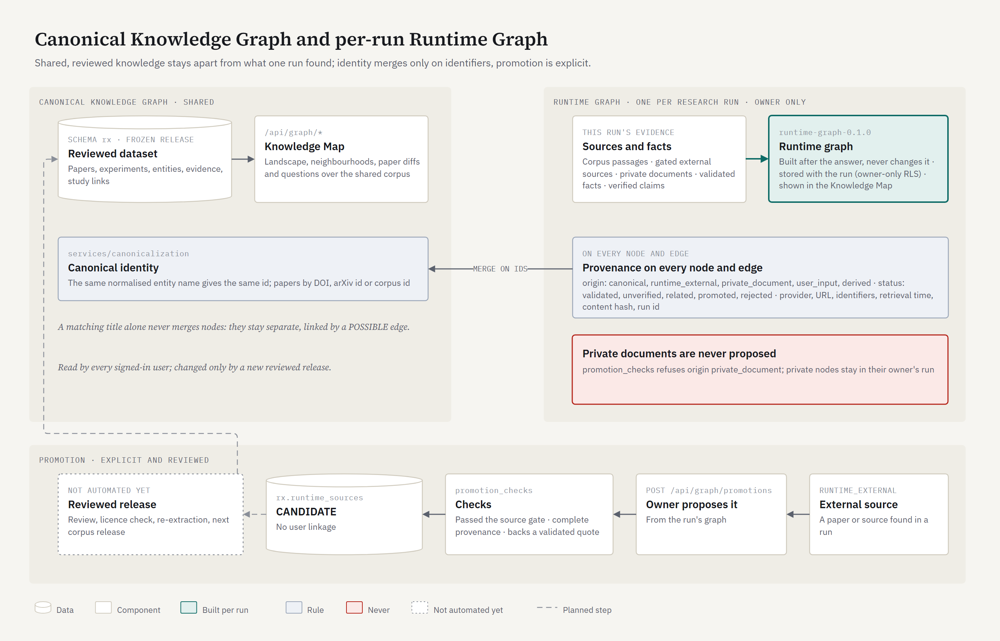
</p>

## Model routing on NVIDIA models

Every generative call goes through one deterministic decision (`routing-0.1.0`, `services/model_gateway/router.py`):
the cheapest suitable NVIDIA model first, escalation only for comparison questions, full-text reading or a failed output,
and at most one validated fallback within the latency budget. Model choice is configuration (`config/models.yaml`).

<p align="center">
  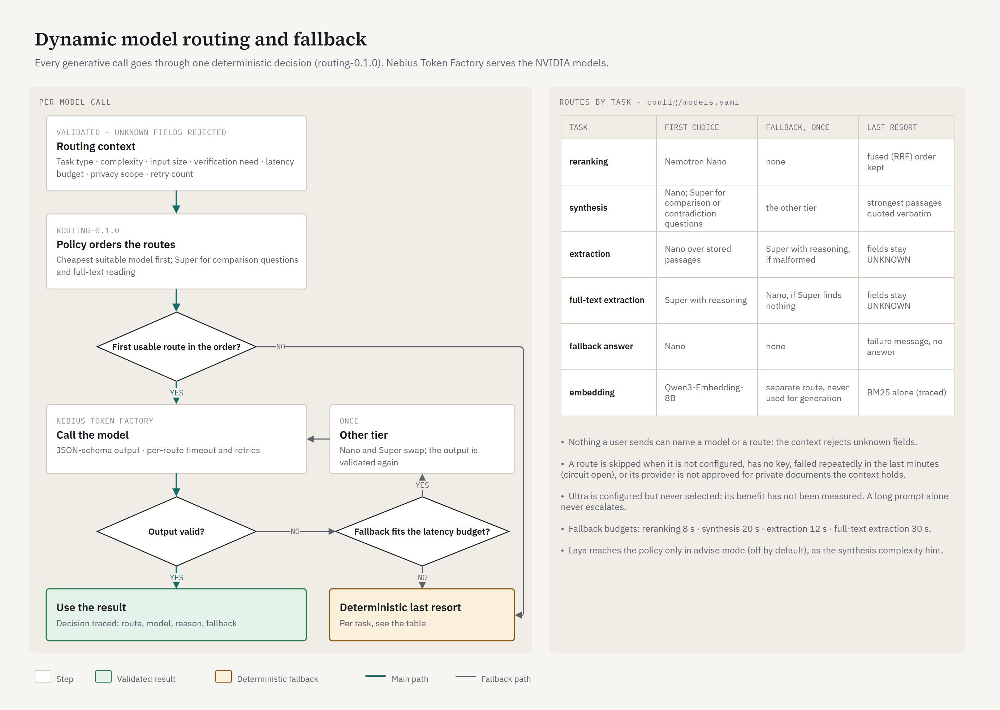
</p>

## Laya: advisory only

Laya is a separate decision service that answers beside every run. In shadow mode (the default) its typed decision is
traced next to the deterministic rules' choice and never applied; the orchestrator stays authoritative. Laya is not part
of the public deployment.

<p align="center">
  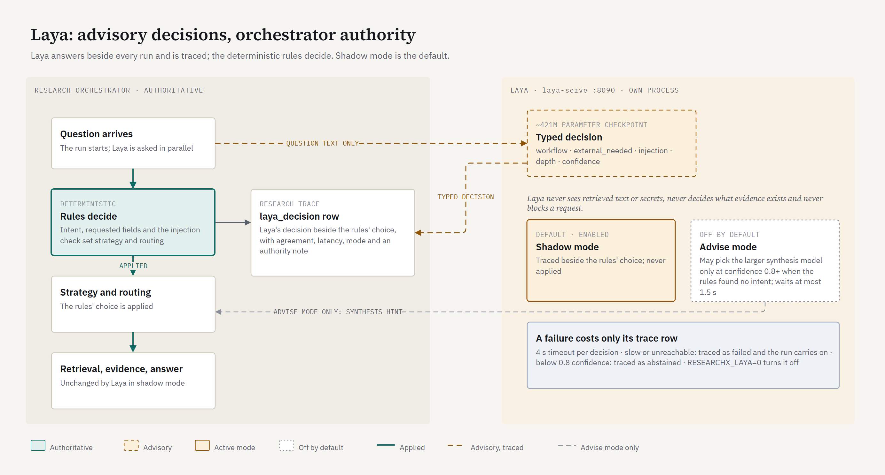
</p>

## Caching

Four separate caches, all scoped to one user: answers and external-provider results in Postgres (row-level security),
query embeddings and reranker grades in process. A hit skips real work; abstentions are never cached, and answer-cache
writes stop when the database reaches 450 MB.

<p align="center">
  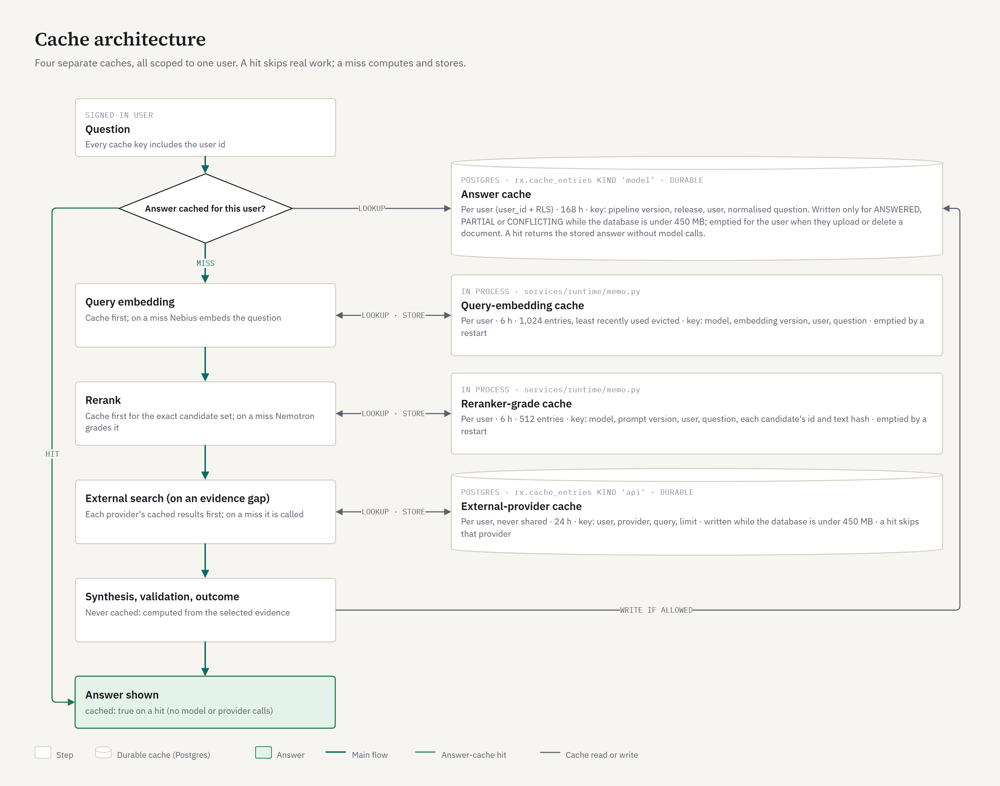
</p>

## Research Trace and observability

<p align="center">
  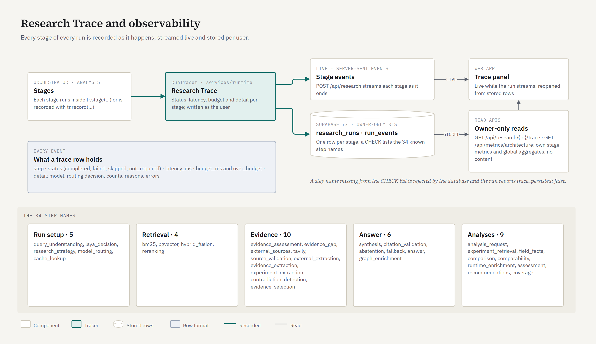
</p>

## Privacy, authentication and isolation

- The browser signs in with Supabase Auth (e-mail and password, Google, GitHub, TOTP MFA) using the publishable key only.
- The API accepts a request only after Supabase Auth has verified its bearer token; users with a verified MFA factor
  must hold an `aal2` session. The user id comes only from that verified token; request bodies reject unknown fields.
- User-owned data (documents, chunks, research runs, trace events, caches, conversations) is read and written as the
  user under PostgreSQL row-level security, so ownership holds even if a route had a bug.
- Private passages may go only to model providers approved for private data (Nebius, the inference provider); they are
  never sent to evidence providers or to Laya, and private documents are never proposed to the shared graph.
- Uploading or deleting a document empties that user's answer cache.
- No credential is in the repository or the browser bundle; secrets live only in the hosts' environment settings.

Google and GitHub sign-in are configured; they were verified only up to the provider's consent screen.

<p align="center">
  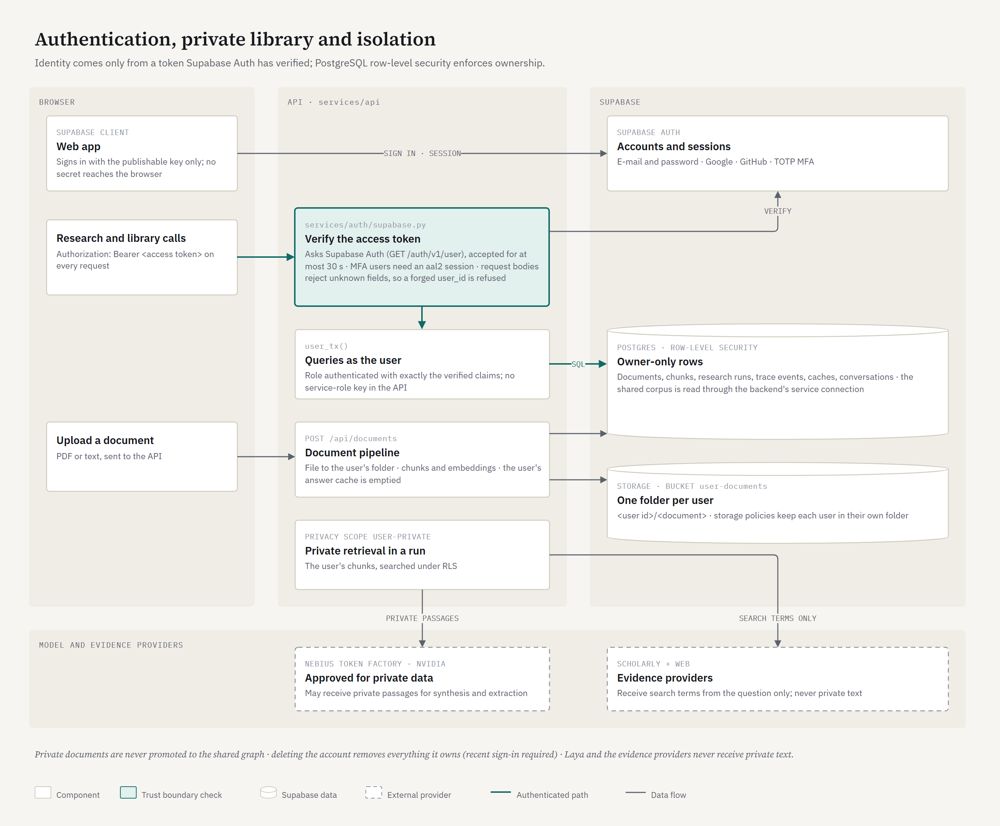
</p>

## Technology

| Layer | Technology |
|---|---|
| Web app | Next.js 16, React 19, TypeScript, Tailwind CSS 4, Cytoscape.js (Knowledge Map), `@supabase/ssr` |
| API and pipeline | Python 3.12+, FastAPI, Pydantic 2, psycopg 3, NumPy, httpx, lxml, pypdf |
| Data | Supabase PostgreSQL (schema `rx`, row-level security, pgvector `halfvec(256)`), Supabase Auth, Supabase Storage |
| Models | Nebius Token Factory: NVIDIA Nemotron 3 Nano 30B-A3B (reranking, synthesis, extraction), Nemotron 3 Super 120B-A12B (comparisons, full-text extraction), Qwen3-Embedding-8B (embeddings) |
| Evidence providers | Semantic Scholar, OpenAlex, arXiv, CORE, OpenReview, Tavily (called only when the corpus evidence is insufficient) |
| Decision layer | Laya (`laya-serve`, separate process): advisory, shadow mode by default |
| Hosting | Vercel (web app), Render (API), Supabase (database, auth, storage) |

## Run it locally

**Prerequisites:** Python 3.12+ with [uv](https://docs.astral.sh/uv/), Node.js 20+, a Supabase project, a Nebius Token
Factory API key.

```bash
# backend
uv sync                                   # installs the API and dev dependencies from uv.lock
cp .env.example .env                      # then fill in your own values (never commit .env)
uv run uvicorn services.api.app:app --host 127.0.0.1 --port 8000

# web app (second terminal)
cd apps/web
npm ci
cp ../.env.example .env.local             # keep only the three web variables listed below
npm run dev                               # http://localhost:3000
```

On Windows, `scripts/dev/start_local.ps1` starts the API, the web app and (optionally) Laya in one window.

### Environment variables

Names only; values belong in `.env` locally and in the hosting platform's secret store in production. `.env.example`
describes each one.

| Where | Variables |
|---|---|
| API (required) | `DATABASE_URL`, `SUPABASE_URL`, `SUPABASE_PUBLISHABLE_KEY`, `NEBIUS_API_KEY` |
| API (evidence providers) | `TAVILY_API_KEY`, `S2_API_KEY`, `OPENALEX_API_KEY`, `CORE_API_KEY`, `RESEARCHX_CONTACT_EMAIL`, `UNPAYWALL_EMAIL` |
| API (operations) | `RESEARCHX_CORS_ORIGINS`, `RESEARCHX_RATE_PER_MIN`, `RESEARCHX_ANALYSIS_PER_MIN`, `RESEARCHX_LAYA` (`0` turns Laya off), `RESEARCHX_LAYA_URL`, `LAYA_API_KEY` |
| Web app | `NEXT_PUBLIC_SUPABASE_URL`, `NEXT_PUBLIC_SUPABASE_PUBLISHABLE_KEY`, `RESEARCHX_API_ORIGIN` |

The web app never receives a database URL, a provider key or a Supabase service-role key; the API process does not use
a service-role key either.

### Database

1. Create a Supabase project and apply the migrations in `supabase/migrations/` in order (for example with
   `supabase db push`). They create schema `rx`, its row-level-security policies, the trace-step whitelist and the
   private `user-documents` storage bucket.
2. Build the corpus release with the dataset pipeline from public sources:
   `uv run python scripts/data/run_pipeline.py --profile initial`. The release itself is not in this repository
   (size and source licences).
3. Load it: `uv run python scripts/db/load_release.py --version 0.2.0`.
4. Embed and load the chunks: `uv run python scripts/retrieval/embed_chunks.py --release 0.2.0`, then
   `uv run python scripts/retrieval/load_embeddings.py --release 0.2.0 --dims 256` (256 dimensions keep the database
   inside the Supabase Free plan; the loader refuses to grow it past 450 MB).
5. Build the BM25 index the API loads at start-up: `uv run python scripts/retrieval/build_bm25.py --release 0.2.0`.

## Evaluation

Measured with the scripts in `scripts/eval/`; the reports are in `data/reports/`. The sets are small and built by the
author from the corpus, so read the numbers as evidence of behaviour, not as benchmark results.

| What | Result | Report |
|---|---|---|
| Citation correctness (quoted span is in the cited source) | 153 / 153 claims; unsupported claims 0 / 153 | `grounding_eval_v0.2.0` |
| Wrong answers when answering a field question | 0 / 57; invented-entity questions answered 0 / 20 | `grounding_eval_v0.2.0` |
| Recorded contradictions reported | 22 / 24 | `grounding_eval_v0.2.0` |
| False abstentions on answerable questions | 9 / 66 (0.136) | `grounding_eval_v0.2.0` |
| Parameter / score values exactly correct | 31 / 40 and 16 / 26 | `grounding_eval_v0.2.0` |
| LLM rerank over hybrid retrieval (TEST + TEMPORAL_TEST, 1024-d) | nDCG@10 +0.051, 95% CI [0.029, 0.074] | `retrieval_eval_v0.2.0` |
| Dynamic routing vs fixed models (36 questions × 4 modes) | field answers 9/12 vs 8/12; passage claims passing citation validation 0.88 vs 0.75 (Nano) and 0.85 (Super); 0 wrong field answers in every mode | `routing_bench_v0.2.0` |
| Answer cache | repeat p50 475 ms vs 5,508 ms on a miss; 5 / 5 identical answers on a hit | `cache_bench_v0.2.0` |
| Laya injection detection (30 hand-labelled prompts) | precision 1.0, recall 0.857 | `laya_eval` |

**Limitations.** The grounding and routing runs used earlier pipeline versions (`grounding-0.3.0`, `pipeline-0.3.6`) than
the current code (`grounding-0.4.0`, `pipeline-0.3.7`), one seed and corpus-only search. The grounding set excluded 162 of
188 score questions whose metric names were table-header noise in the silver data. The deployed retrieval uses 256-d
embeddings to fit the Free plan; on TEST + TEMPORAL_TEST that hybrid is +0.028 nDCG@10 over BM25 with a 95% CI that
crosses zero ([-0.008, 0.062]). Passage answers have no gold labels, so only their citation validity is measured.
Request-time extraction of results from papers outside the corpus is only partially verified: settings were found in a
live check, but no result row passed the deterministic checks. Laya's labels are the author's, on a small set, and Laya
runs in shadow mode only.

## Deployment

One public web address: the Next.js app on **Vercel** serves the UI and forwards `/api/*` on the server side to the
FastAPI backend on **Render**, which talks to Supabase, Nebius and the evidence providers. Laya is not deployed
(`RESEARCHX_LAYA=0`).

<p align="center">
  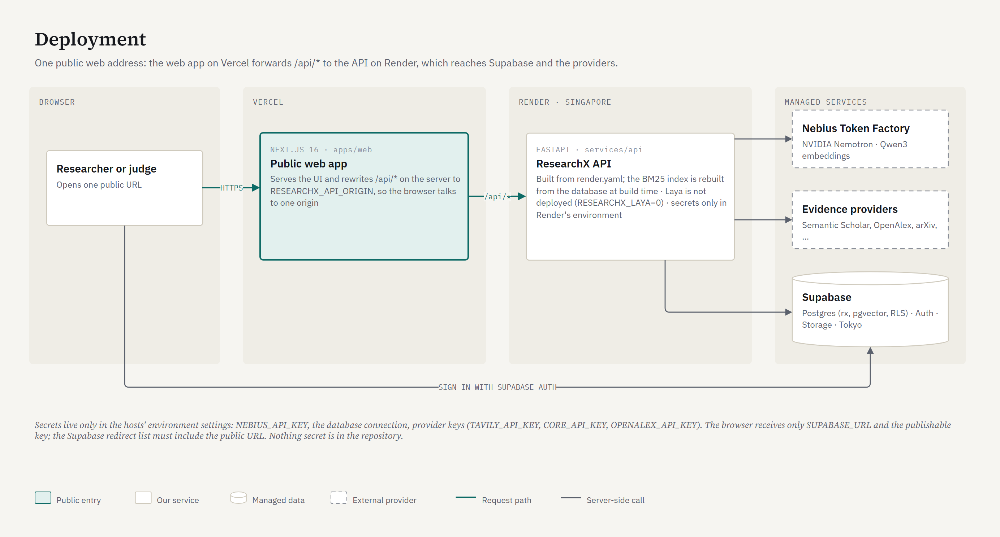
</p>

1. **Backend (Render).** Create a Web Service from this repository (or apply `render.yaml` as a Blueprint):
   build `pip install uv && uv sync --frozen && uv run python scripts/retrieval/build_bm25.py --release 0.2.0`,
   start `uv run uvicorn services.api.app:app --host 0.0.0.0 --port $PORT`, health check `/api/health`. Set the API
   variables above as secret environment variables, plus `RESEARCHX_LAYA=0` and `RESEARCHX_CORS_ORIGINS=<web URL>`.
2. **Web app (Vercel).** Import the repository with root directory `apps/web` (framework: Next.js) and set
   `NEXT_PUBLIC_SUPABASE_URL`, `NEXT_PUBLIC_SUPABASE_PUBLISHABLE_KEY` and `RESEARCHX_API_ORIGIN=<Render service URL>`.
3. **Supabase Auth.** Add the Vercel URL to *Authentication → URL Configuration* (site URL and redirect URLs), and to the
   Google and GitHub provider settings if those are used.

The diagrams are draw.io files in [`diagrams/`](diagrams), generated by `diagrams/src/build.py` and exported with
`diagrams/src/render.mjs`; open any `.drawio` file in [draw.io](https://app.diagrams.net) to edit it.

## License

ResearchX is released under the [MIT License](LICENSE).
