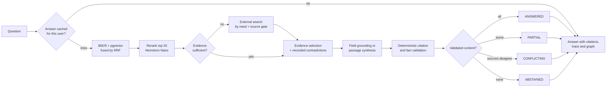

# ResearchX

**An evidence-first research assistant for machine-learning literature.** Ask a question about published experiments and
ResearchX answers from a curated corpus of papers, with every claim tied to a verbatim quote from its source. When the
evidence is missing it says so instead of guessing, and when sources disagree it shows both. Eight analyses help
researchers compare papers, investigate discrepancies, rebuild experimental recipes and decide what to test next.

<p align="center">
  
</p>

## Try it

**Live demo: [researchx-navy.vercel.app](https://researchx-navy.vercel.app)**

**Full walkthrough video (21 min, best at 1.5×): [walkthrough/ResearchX_Full_Walkthrough.mp4](walkthrough/ResearchX_Full_Walkthrough.mp4)**
· [about the demo videos](#demo-videos)

A shared account is available for judges and reviewers:

| | |
|---|---|
| E-mail | `researchx.judge@example.com` |
| Password | `Judge-y-eIoSavnrZp-2026` |

> [!WARNING]
> **This is a shared account.** Everyone who reads this page can sign in with it. **Do not upload private or sensitive
> documents to its private library:** anything uploaded there is visible to every other person using the account and
> may be deleted at any time. To try the private library with your own documents, sign up with your own e-mail address.

A good first question: *"What learning rate and batch size were used to train HRNetV2 + OCR on ADE20K?"* Then open
**Research Trace** and **Knowledge Map** on the answer. The backend runs on Render's Free plan: if nobody has used it for
a while, the first request can take up to a minute while the service starts.

**Current limits of the public deployment**

- **Answer caching is paused.** The Supabase Free plan holds 500 MB and the database is above the 450 MB write guard, so
  new answers and provider results are not stored and a repeated question is not served with `cached: true`. Lookups
  still run, and the in-process cache still works: ask the same question twice (the flagship question above is a good
  test) and the second run's Research Trace shows the query embedding served from cache (`embedding_cache: hit`)
  instead of a new model call. Answer caching resumes as soon as the database is below the guard again.
- **Laya is off** because of the Free-plan constraints (see [Laya](#laya-advisory-only) for how to turn it on).

### Demo videos

- **Hackathon submission demo:** we submitted a shorter version of the ResearchX demo to keep the main presentation
  concise.
- **Full detailed walkthrough:** for a complete, in-depth tour of ResearchX, including its research workflow, retrieval
  pipeline, model routing, specialized analysis tools, Knowledge Map, evidence handling, caching, document library,
  security, and NVIDIA Nemotron integration through Nebius Token Factory, watch the
  **[full walkthrough](walkthrough/ResearchX_Full_Walkthrough.mp4)** (21 min, 1920×1080, 88 MB; GitHub may offer it as a
  download rather than play it in the page).
- **Recommended playback speed: 1.5×** for a faster viewing experience.

The walkthrough was recorded on the live deployment on 2026-10-21 and narrated with a synthetic voice. Everything shown
in the application is real output. It also says where the public deployment differs from the full design: Laya is off
and answer-cache writes are paused (the limits above), and the architecture diagrams and offline evaluation figures near
the end are explanations, not live output.

The suggested path through the product:

<p align="center">
  
</p>

## What it does

- **Cited answers.** Hybrid retrieval (BM25 + pgvector) and an LLM reranker find passages; NVIDIA Nemotron models
  synthesise an answer whose every claim must quote its source verbatim, or the claim is removed.
- **Field-level grounding.** Questions about hyperparameters or scores are answered from validated values: each value
  needs a verbatim span and matching evaluation conditions (dataset, split, protocol, metric definition, stage).
- **Contradictions and abstention.** Recorded conflicts between sources are reported as `CONFLICTING`; when the
  evidence is insufficient the answer is `ABSTAINED` with *"Insufficient evidence found."* and what was searched.
- **Research Trace.** Every stage of every run (34 step types) is streamed live and stored per user: timing, budget,
  the model routing decision, cache hits and why anything was skipped.
- **Knowledge Map.** The shared, reviewed corpus graph beside the per-run runtime graph, with provenance on every node
  and edge. External sources can be proposed for review; private documents never can.
- **Private library.** Each user's uploaded documents are searched only for that user, under row-level security.

## Nebius Token Factory & NVIDIA AI Integration

Every model call in ResearchX goes through **Nebius Token Factory**, and the language work is done by **NVIDIA Nemotron**
models: ranking retrieved passages, writing cited answers and extracting experimental settings. Embeddings for semantic
search come from Qwen3-Embedding-8B, also served by Nebius. The models do the language work; deterministic code decides
what counts as evidence, checks every citation and decides when to abstain.

### How ResearchX connects to Nebius Token Factory

- **One gateway, one OpenAI-compatible API.** Application code never calls a provider directly: it asks
  `services/model_gateway/gateway.py` for a *task* (reranking, synthesis, extraction, embedding). The gateway talks to
  Nebius Token Factory's OpenAI-compatible endpoint configured in `config/models.yaml`
  (`https://api.tokenfactory.nebius.com/v1/`) over plain HTTPS, authenticated with the `NEBIUS_API_KEY` bearer token:
  `GET /models` resolves the configured model names against the account's live catalog, `POST /chat/completions`
  generates (temperature 0, `response_format` set to a strict `json_schema`), and `POST /embeddings` embeds.
- **Models are configuration.** Each task lists its candidate models, timeout, retry budget and token limit in
  `config/models.yaml`; changing a model needs no code change.
- **Failure handling.** Each route has its own timeout and retries; a route that fails three times within five minutes is
  skipped until the window passes (health circuit). Call records keep hashes and sizes, never prompt text or keys.
- **Private data.** Nebius is the only provider approved for private documents (`private_data: true`); the router never
  sends a context containing private passages to a provider without that flag, and evidence providers never receive them.

### Which model does what

| Model / provider | ResearchX responsibility | When it is used | Implementation status |
|---|---|---|---|
| **NVIDIA Nemotron 3 Nano 30B-A3B** (Nebius) | Reranking: grades the top 20 retrieved passages 0–3 | Every research run that retrieves (not on an answer-cache hit) | Active in production (verified 2026-10-16) |
| Nemotron 3 Nano 30B-A3B | Passage synthesis: claims, each with a verbatim quote and its source | Routine questions | Active in production (verified 2026-10-16) |
| Nemotron 3 Nano 30B-A3B | Field extraction: requested settings and values with verbatim spans, from stored passages | Parameter and score questions whose values the validated records do not already hold | Implemented; not separately exercised in the production checks |
| Nemotron 3 Nano 30B-A3B | Experiment extraction in the offline dataset pipeline | Building the corpus release | Implemented (offline, not in the request path) |
| **NVIDIA Nemotron 3 Super 120B-A12B** (Nebius) | Synthesis for comparison and contradiction questions | When the question's intent is a comparison or a contradiction | Active in production (verified 2026-10-16) |
| Nemotron 3 Super 120B-A12B | Full-text extraction with reasoning enabled | Analyses that read a paper's full text, and papers read at request time | Implemented; verified locally (2026-10-14/15), not in the production checks |
| Nano ↔ Super | One validated fallback to the other tier | An output fails schema or citation validation and the latency budget still has room | Implemented; every use is traced |
| **Qwen3-Embedding-8B** (Nebius; not an NVIDIA model) | Query and document embeddings for pgvector, stored at 256 dimensions | Every retrieval (cached per user in process for 6 h) | Active in production (verified 2026-10-16) |
| NVIDIA Nemotron 3 Ultra 550B-A55B, Llama-3.1-Nemotron-Ultra-253B (Nebius) | Configured for difficult verification | Never selected by `routing-0.1.0`: its benefit has not been measured | Configured, not used |
| **Tavily** | Web search for external sources | Only when the corpus evidence is insufficient, for setting, score or open passage questions | Active in production (verified 2026-10-16) |
| Laya (`laya-serve`) | Advisory decision hints, traced beside the rules' choice | Shadow mode only | Disabled in the public deployment (Free-plan limits) |

### How a model is chosen, checked and recorded

- **Routing.** Every generative call builds a validated routing context (task type, complexity, input size, verification
  need, latency budget, privacy scope, retry count) and the deterministic policy `routing-0.1.0`
  (`services/model_gateway/router.py`) returns the route, the model, the reason and the fallback. Nothing a user sends
  can name a model.
- **Cheapest suitable model first.** Nano handles reranking, routine synthesis and extraction; Super is used where it has
  been measured to help: comparison questions, and full-text extraction, where Nano returned values without verbatim
  spans (every one rejected by validation in a 2026-10-14 check). A long prompt alone never escalates. Reasoning is
  switched off on the routine routes: in a 2026-10-01 probe this cut one extraction from 14.8 s and 1,251 output tokens to
  2.9 s and 295 tokens with a complete, quote-grounded answer. On the small routing benchmark (36 questions × 4 modes,
  `data/reports/routing_bench_v0.2.0.md`), dynamic routing answered 9 of 12 field questions exactly (fixed models: 8 of
  12) with no wrong field answer in any mode.
- **Fallbacks and last resorts.** When an output fails validation, the other tier is tried once if the latency budget
  allows; otherwise a deterministic last resort applies: the fused retrieval order is kept (reranking), the strongest
  passages are quoted verbatim and marked as such (synthesis), or the fields stay unknown (extraction). A model never
  overrides an abstention.
- **Validation before anything is shown.** Outputs are parsed against the requested JSON schema and validated again in
  code (`services/model_gateway/structured.py`). Then the evidence checks run: a claim survives only if its quote appears
  verbatim in the cited source and contains the claim's numbers, and an extracted value only if its span holds the value
  under matching evaluation conditions.
- **Recorded in the Research Trace.** Each model call stores its routing decision (selected route and model, reason,
  fallback route and model, every attempt with status, latency and tokens, privacy scope, policy version). The retrieval
  stage records the embedding model, its latency and whether the embedding came from cache; the reranking stage records
  the model and whether the grades were cached.

### Tavily: External Research Discovery

ResearchX always searches its own corpus first. Only when the reranked evidence is insufficient (no passage graded 3 and
fewer than two graded 2+, or the question's rare terms missing from them) does the run record an evidence gap and look
outside, and only with the providers suited to what is missing:

| Missing evidence | Providers asked |
|---|---|
| A setting value (learning rate, batch size, …) | Semantic Scholar, arXiv, **Tavily** |
| A score | Semantic Scholar, arXiv, OpenAlex, **Tavily** |
| An open passage question | Semantic Scholar, OpenAlex, arXiv, CORE, OpenReview, **Tavily** |
| Literature coverage, named papers, critiques | Scholarly providers only (no Tavily) |

- **The call.** Tavily receives the question as asked (the scholarly APIs receive keyword terms) and runs one basic
  search for 5 results (1 credit). ResearchX asks for sources only (`include_answer: false`), never a generated answer.
- **Budgets.** All providers run in parallel: 8 s per request (3 s to connect), 9 s for the whole external phase, and once
  one provider has answered the others get at most 2.5 s more. A rate-limited request (HTTP 429) is retried once after
  1 s. Provider results are cached per user for 24 h, written only while the database is under its 450 MB guard.
- **Validation and provenance.** Every result passes a deterministic source gate (`services/runtime/tools.py`): HTTPS
  only, no instruction-like text (an injection-like title is never echoed), no duplicate URL, DOI or arXiv id (the other
  providers that found the same work are recorded instead), and enough content. Accepted results keep their provider,
  URL, retrieval time, content hash and a reliability tier (scholarly, technical, web), and are recorded in
  `rx.runtime_sources` without any link to the user who searched. Rejected results are not stored.
- **Four different things.** *Discovery* is a search result. It becomes *evidence* only after passing the gate and being
  selected (at most 4 external sources per answer). It becomes a *citation* only when a claim quoting it passes the
  verbatim-quote check. It becomes part of the *permanent corpus* only through an explicit, reviewed promotion
  (proposal → `CANDIDATE` → reviewed release, which is not automated yet); external search never writes to the corpus.
- **Degraded mode.** Without `TAVILY_API_KEY` Tavily is skipped; a timeout or error is traced as failed or cut off; either
  way the other providers still answer within the phase, and with no usable external evidence the run answers from the
  corpus or abstains. Every provider's status, result count and error is in the run's trace.

### Request flow

```mermaid
flowchart LR
    Q["Research question"] --> C{"Answer cached<br/>for this user?"}
    C -- "hit" --> OUT["Answer with citations<br/>+ Research Trace"]
    C -- "miss" --> H["Internal hybrid retrieval<br/>BM25 + pgvector<br/>(Qwen3-Embedding-8B via Nebius)"]
    H --> RR["Rerank top 20<br/>(Nemotron Nano via Nebius)"]
    RR --> S{"Evidence<br/>sufficient?"}
    S -- "yes" --> SEL["Evidence selection<br/>+ recorded contradictions"]
    S -- "no: evidence gap" --> X["External discovery by need<br/>scholarly APIs, Tavily for some gaps"]
    X --> G["Source gate<br/>HTTPS, no instruction-like text,<br/>dedup, min content, provenance"]
    G --> SEL
    SEL --> RT{"Routing policy<br/>routing-0.1.0"}
    RT -- "routine" --> N["Nemotron Nano via Nebius<br/>synthesis or field extraction"]
    RT -- "comparison or full text" --> SU["Nemotron Super via Nebius"]
    N --> V["Deterministic validation<br/>verbatim quotes, numbers, conditions"]
    SU --> V
    V --> ST["ANSWERED, PARTIAL,<br/>CONFLICTING or ABSTAINED"]
    ST --> OUT
```



Not every request calls every model: an answer-cache hit calls none, external discovery runs only on an evidence gap,
and Super is used only for comparisons, full-text reading or a validated fallback.

### Configuration

| Variable | Purpose |
|---|---|
| `NEBIUS_API_KEY` | Nebius Token Factory (all generation and embeddings). Required for model calls |
| `TAVILY_API_KEY` | Tavily web search. Optional: without it Tavily is skipped |
| `OPENALEX_API_KEY` | OpenAlex with its own quota. Optional, but keyless requests from shared hosting IPs are often rate-limited |
| `RESEARCHX_CONTACT_EMAIL` | Contact address sent to OpenAlex as `mailto`. Optional |
| `S2_API_KEY`, `CORE_API_KEY`, `UNPAYWALL_EMAIL` | Other evidence providers. Optional |

Model routes live in `config/models.yaml`; provider routing, timeouts and cache settings in `config/runtime.yaml`.
Locally, copy `.env.example` to `.env` (git-ignored) and fill in values. On Render, add the same names as secret
environment variables in the service's *Environment* settings (or run
`scripts/deploy/render_service.py set-env <NAME> <value>`) and redeploy. `GET /api/health` reports which providers
are configured (`nebius_models`, `tavily`, `semantic_scholar_key`) as true or false, never their values.

| Symptom | Likely cause and fix |
|---|---|
| Model stages fail with 401/403, or `/api/health` shows `nebius_models: false` | `NEBIUS_API_KEY` missing or invalid: set it and redeploy. Runs still finish, degraded (BM25 only, fused order, quoted passages) |
| A model route reports a model as unavailable | The configured name is not in the account's catalog: compare the candidates in `config/models.yaml` with `GET /models` |
| A route is skipped after repeated errors | The health circuit opened after three failures within five minutes; it closes when the window passes |
| Tavily traced as failed or cut off | Timeout, exhausted credits or a missing key; check the key and credits. The other providers still answer |
| OpenAlex returns HTTP 429 | Keyless requests share the host's IP allowance: set `OPENALEX_API_KEY` (and `RESEARCHX_CONTACT_EMAIL`) |
| A provider is traced as skipped | Its key is not set in that environment |
| The trace shows `fallback_used: true` or an extractive answer | The first model's output failed validation or the route was unavailable; the trace records each attempt and the reason |

### Why this combination matters

- **Nebius Token Factory is the inference layer:** one OpenAI-compatible endpoint serves every model ResearchX uses,
  selected per task by configuration.
- **NVIDIA Nemotron models do the research-specific language work** in their measured roles: Nano for high-volume
  reranking, routine synthesis and extraction, Super for comparisons and long full-text reading.
- **Tavily extends the search beyond the corpus** when the internal evidence falls short, behind the same source gate and
  citation checks as everything else.
- **ResearchX ties these together into one research workflow** (retrieval, evidence validation, model routing,
  provenance, citations and abstention), every step recorded in the Research Trace, rather than a general-purpose chatbot.

## Architecture

ResearchX has two halves. An **offline dataset pipeline** builds a frozen, validated corpus release from public
scholarly sources; the **online system** answers questions over that release and reaches outside it only when the corpus
evidence is insufficient. Everything that decides what counts as evidence is deterministic code: models are used for
reranking, synthesis and extraction, while evidence sufficiency, citation checks, comparability, model routing and
abstention are plain, versioned rules whose every decision is written to the Research Trace.

### Components

**Web app (`apps/web`).** A Next.js 16 App Router application: research chat, Knowledge Map (Cytoscape.js), Analyze,
private library and settings. Every page sits behind an auth gate (`proxy.ts`) that asks Supabase Auth to validate the
session on each load, refreshes the session cookies, sends signed-out visitors to `/login` and sends a password-only
session of an MFA user to `/mfa`. The browser only ever talks to this origin: `next.config.ts` rewrites `/api/*` on the
server to the API, so no backend address, database URL or provider key reaches the browser, and a strict
Content-Security-Policy allows connections only to this origin and the Supabase project.

**API (`services/api`).** A FastAPI application. Every route except `/api/health` requires a Supabase access token; the
token is verified by Supabase Auth itself (`services/auth`, accepted for at most 30 s) and the user id comes only from
that verified token, never from a request body (bodies reject unknown fields). User-owned data is read and written inside
`user_tx()`: SQL runs as role `authenticated` with exactly the verified claims, so PostgreSQL row-level security enforces
ownership even if a route had a bug. Research runs can return JSON or stream their stages as server-sent events (with
`no-transform`, so the web proxy does not buffer them). Per-user rate limits protect the model and provider budgets.

**Research orchestrator (`services/runtime`).** Runs one question through a fixed pipeline (below), records every stage
with its latency, budget and decision detail, builds the run's runtime graph after the answer exists and stores the
result. It also owns the external-provider phase and its source gate (`tools.py`), the arXiv full-text reader, the
private-document pipeline and the in-process caches.

**Retrieval (`services/retrieval`).** BM25 over the corpus chunks (an in-process index built from the release),
pgvector search over 256-dimensional Qwen3-Embedding-8B vectors, reciprocal rank fusion and an LLM reranker, plus the
clients of the scholarly sources. A retrieval scope is mandatory on every call: private documents are searched only for
their owner, inside a transaction running as that user and with an explicit owner filter.

**Evidence and grounding (`services/evidence`).** Parses what a question asks for (model, dataset, fields, metric) and
validates every extracted value: the quoted span must be in the passage and hold the value, and evaluation conditions are
compared after normalisation (`val` equals `validation set`; a narrower or unrecognisable condition stays unknown).

**Model gateway (`services/model_gateway`).** One client for Nebius Token Factory: model names are resolved against the
provider's live catalog, each route has its own timeout and retry budget (`config/models.yaml`), a route that failed
repeatedly in the last minutes is skipped (health circuit), and every structured output is validated against its schema
before use. The routing policy `routing-0.1.0` decides which model serves each call.

**Analyses (`services/analysis`), comparison (`services/comparison`) and graphs (`services/graph`).** The eight analyses
share field facts, configuration identity (pre-training, fine-tuning and evaluation settings kept apart), the
field-by-field comparison engine and request-time full-text reading. The canonical Knowledge Map is built from the
release; the runtime graph of each run is stored with the run.

**Data (`supabase/`).** One Supabase project: PostgreSQL schema `rx` with row-level security on every table, pgvector,
Supabase Auth and a private Storage bucket for uploaded files.

| Part | Responsibility |
|---|---|
| `apps/web` | Next.js app, auth gate, `/api/*` rewrite, Content-Security-Policy |
| `services/api` | FastAPI routes: research runs (JSON or SSE), traces, conversations, documents, Knowledge Map, analyses, metrics |
| `services/auth` | Bearer-token verification with Supabase Auth; claims for running SQL as the user |
| `services/runtime` | Research orchestrator, external providers and source gate, full-text reader, private documents, caches, Research Trace |
| `services/retrieval` | BM25, hybrid fusion, LLM reranking, scholarly source clients, retrieval scope |
| `services/evidence` | Request parsing, field-level grounding, condition normalisation |
| `services/model_gateway` | Nebius client, routing policy, structured-output validation |
| `services/analysis` | The eight analyses, field facts, configuration identity, request-time reading, runtime papers |
| `services/comparison` | Comparison engine, conflicts, comparison candidates, study links |
| `services/graph` | Canonical Knowledge Map and per-run runtime graph |
| `services/canonicalization` | Normalisation of titles, DOIs, arXiv ids and entity names; canonical ids |
| `services/extraction`, `services/datasets` | Dataset pipeline: parsing, extraction, schemas, validation, releases |
| `services/laya` | Client of the Laya decision service |
| `config/` | `runtime.yaml` (retrieval, evidence, caches, budgets, Laya), `models.yaml` (model routes), `pipeline.yaml`, `domain.yaml` |
| `supabase/migrations` | Schema `rx`, row-level-security policies, trace-step whitelist, storage bucket |
| `scripts/` | Dataset pipeline, loading, embeddings, BM25 build, evaluations, deployment helpers, local start script |

### The life of a question

1. **Understand.** The question is parsed for intent, entities and requested fields; the strategy and a model route per
   call are fixed and traced. The query embedding starts in parallel, with a second request sent if the first has not
   answered after 0.45 s.
2. **Answer cache.** A per-user lookup keyed by pipeline version, release, user and normalised question. A hit returns
   the stored answer without any model call.
3. **Retrieve.** BM25 top 50 and pgvector top 50 (exact cosine) are fused by reciprocal rank (k = 10, dense weight 2.0,
   both tuned on the validation split). If the embedding call takes longer than 5 s, the run continues on BM25 alone.
4. **Rerank.** Nemotron Nano grades the top 20 candidates 0–3; if the reranker fails, the fused order is kept.
5. **Assess.** Evidence is sufficient when at least one passage is graded 3 or two are graded 2+, *and* the question's
   rare terms appear in them; otherwise the run records an evidence gap.
6. **External search (only on a gap).** Providers are chosen by what is missing (setting values, scores, passages,
   literature, papers or critique), queried in parallel with an 8 s request timeout and a 9 s deadline for the whole
   phase, and served from a per-user cache when possible. Every result passes the source gate (HTTPS, no
   instruction-like text, not a duplicate, enough content). For a missing setting value, one arXiv full text is read.
7. **Select.** Up to 8 corpus passages graded 2+ and up to 4 external sources, with any recorded contradictions about the
   same papers or experiments.
8. **Answer.** Parameter and score questions go through field-level grounding; other questions through passage
   synthesis (Nano, or Super for comparison questions). Every claim carries a verbatim quote and its source number.
9. **Validate.** Deterministic checks keep a claim only if its quote is in the cited source and contains the claim's
   numbers; the answer is rebuilt from the surviving claims. If passages graded sufficient yield no valid claim, external
   search runs once before the run abstains.
10. **Outcome and persistence.** `ANSWERED`, `PARTIAL`, `CONFLICTING` or `ABSTAINED`. The trace rows, the retrieval trace
    and the runtime graph are stored with the run; the answer is cached when it is not an abstention and the database is
    under the write guard.

### Resilience: what happens when a dependency fails

| Dependency | If it is missing, invalid or down |
|---|---|
| An evidence provider key (Semantic Scholar, OpenAlex, CORE, Tavily) | That provider fails or is skipped, and the failure is traced; the other providers still answer within the 9 s phase. The answer uses whatever passed the source gate, or the corpus alone, or abstains. Providers are called only when the corpus evidence is insufficient. |
| Nebius (models) | Degraded, not down: embeddings fail over to BM25 alone, reranking keeps the fused order, synthesis falls back to quoting the strongest passages verbatim (clearly marked), and extraction leaves fields unknown. |
| Laya | Nothing changes: it is advisory, and its absence or failure costs only its trace row. |
| Supabase (Auth or database) | The application cannot serve: nobody can sign in, tokens cannot be verified, and `/api/health` reports the database as unreachable. |

Every one of these outcomes is visible in the run's Research Trace, so a degraded answer is never presented as a normal one.

### Configuration

Behaviour that may change is configuration, not code. `config/runtime.yaml` holds the release and pipeline version
(part of the answer-cache key), retrieval depths and fusion weights, evidence thresholds, provider routing, timeouts and
deadlines, cache lifetimes and the write guard, the Laya mode and the per-stage latency budgets. `config/models.yaml`
holds the model routes, their timeouts, retries and measured typical latencies. Secrets are only ever read from the
environment.

### Data model

Corpus tables are shared and read only by the backend; user-owned tables carry owner-only row-level-security policies;
uploaded originals sit in a private Storage bucket, one folder per user.

<p align="center">
  
</p>

### Dataset pipeline

The corpus is built offline by `scripts/data/run_pipeline.py`: discovery from OpenAlex and arXiv, enrichment from
Semantic Scholar, arXiv and Papers with Code, full-text parsing, experiment and evidence extraction (deterministic rules
plus schema-bound Nemotron extraction, every value with its evidence), comparison and contradiction building, a human
review loop, validation, leakage and licence checks, and a frozen release that is loaded into Supabase, embedded and
indexed. Every acquisition stage is cached and resumable, and a failed validation stops the build.

<p align="center">
  
</p>

## How a question is answered



<p align="center">
  
</p>

## Citations, provenance, conflicts and abstention

<p align="center">
  
</p>

- A claim survives only if its quote appears verbatim in the source it cites and contains the claim's numbers
  (deterministic check, no LLM judge). The answer is rebuilt from the surviving claims.
- Field values carry their evidence and a status: `REPORTED`, `DERIVED` (with the rule that derived it), `CONFLICTING`
  or `UNKNOWN`. Unknown fields stay unknown; nothing is filled from defaults or similarity.
- Training settings keep their stage (pre-training, fine-tuning, evaluation): a pre-training learning rate is never
  compared with a fine-tuning one.
- External text passes a source gate before use: HTTPS only, instruction-like text rejected, duplicates dropped.
- Model routing never overrides an abstention, and Laya never decides what evidence exists.

## The eight analyses

| Analysis | What it answers |
|---|---|
| **Paper-to-Paper Diff** | How do two to four papers differ, field by field and training stage by training stage, and is the comparison fair? |
| **Result Discrepancy Investigator** | Why do two similar experiments report different results: verified differences versus what is simply not stated? |
| **Reproducibility Recipe Builder** | What exactly would I need to reproduce this experiment? Unstated settings stay `UNKNOWN`, never defaulted. |
| **Next Experiment Planner** | Which experiment (reproduce, ablate, transfer) would most reduce the uncertainty around a result? |
| **Claim-to-Evidence Auditor** | Do the corpus records support a stated comparison, reported value or training setting? |
| **Generalization and Transferability Analyzer** | Where else was a model evaluated, and which conditions (pre-training data, adaptation) changed? |
| **Literature Review Completeness Auditor** | What does a question or draft review cover, and what does the corpus suggest it leaves out? |
| **Benchmark Reality Explorer** | Every reported result for a benchmark and metric, classified `COMPARABLE`, `CONDITIONALLY_COMPARABLE`, `INCOMPATIBLE` or `UNKNOWN`. |

Each analysis call is a traced research run of the caller, so it has its own Research Trace. All eight read the same
validated records through the same foundation:

- **Field facts.** Every setting of an experiment is `REPORTED`, `DERIVED` (with its rule), `CONFLICTING` or `UNKNOWN`,
  and keeps its evidence.
- **Configuration identity.** Settings are split into pre-training, fine-tuning and evaluation configurations, read from
  the evidence itself (the stage cue nearest the value, else the section heading), and linked evaluation → fine-tuning →
  pre-training. A value whose stage is not stated is never compared with a staged one.
- **Comparison engine.** Experiments are compared field by field after normalisation; `UNKNOWN` is never a match, and
  the label ladder runs from `CONFLICTING_EVIDENCE` and `RELATED_CONTEXT` through `MATERIALLY_DIFFERENT` and
  `INSUFFICIENT_EVIDENCE` to `ALIGNED_EXPERIMENT`.
- **Request-time reading.** Before an analysis shows a setting as not stated, the passages of the paper that name it are
  read and checked; a value that passes becomes `DERIVED` with its quote.
- **Runtime papers.** Paper-to-Paper Diff and Benchmark Reality Explorer can also read papers outside the corpus: a typed
  reference resolves by identifier first (never by similarity alone), the arXiv full text or abstract is read, and the
  rows that pass the deterministic checks are served beside corpus records through an overlay, marked runtime and
  unreviewed. Nothing is written to the corpus.

<p align="center">
  
</p>

## Knowledge Map: canonical and runtime graphs

The shared graph comes from the reviewed corpus release; each research run also builds its own runtime graph from the
evidence it used, after the answer exists, so the graph never changes the answer. Every node and edge records its
origin, status and provenance (provider, URL, identifiers, retrieval time, content hash, run). Identity merges only on
identifiers (DOI, arXiv id, corpus id, canonical entity key); a matching title alone never merges nodes. Promoting an
external source to the shared corpus is an explicit, reviewed step, and private documents are never proposed.

<p align="center">
  
</p>

## Model routing on NVIDIA models

Every generative call goes through one deterministic decision (`routing-0.1.0`): a validated routing context (task type,
complexity, input size, verification need, latency budget, privacy scope, retry count) goes in; the route, the model, the
reason and the fallback come out and are traced. The cheapest suitable model comes first; Super serves comparison
questions and full-text reading; the other tier is tried once when an output fails validation and the latency budget
still has room; each task has a deterministic last resort. Nothing a user sends can name a model, and a provider that is
not approved for private data never receives a private context.

<p align="center">
  
</p>

## Laya: advisory only

Laya is a separate decision service (`laya-serve`, an English checkpoint of about 421M parameters) that answers beside
every run with a typed decision: workflow, whether external evidence is needed, an injection check and a depth. In
shadow mode, the default, its decision is traced next to the deterministic rules' choice and never applied; the
orchestrator stays authoritative. A slow or unreachable Laya is traced as failed after 4 s and the run carries on.

**Laya is off in the public deployment because of the Free-plan constraints:** the model takes about a minute and more
memory than Render's Free instance offers to load, and about a second per decision. Answers do not change without it,
since it is advisory. To turn it on:

1. Run `laya-serve` (installed separately) on a host with enough memory, reachable from the API.
2. On the API service, remove `RESEARCHX_LAYA=0` (or set it to `1`), set `RESEARCHX_LAYA_URL` to the service address and
   `LAYA_API_KEY` if the service requires one, then redeploy.
3. Laya then runs in shadow mode. Advise mode, in which it may pick the larger synthesis model when its confidence is at
   least 0.8 and the rules found no intent, is enabled only by setting `laya.mode: advise` in `config/runtime.yaml`.

<p align="center">
  
</p>

## Caching

Four separate caches, all scoped to one user, so nothing derived from one user's question or private documents is ever
served to another:

- **Answer cache** (Postgres, 168 h): keyed by pipeline version, release, user and normalised question; written only for
  `ANSWERED`, `PARTIAL` or `CONFLICTING` runs while the database is under 450 MB; emptied for a user who uploads or deletes
  a document.
- **External-provider cache** (Postgres, 24 h): each provider's results per user and query, under the same write guard.
- **Query-embedding cache** (in process, 6 h, 1,024 entries) and **reranker-grade cache** (in process, 6 h, 512 entries,
  keyed by every candidate's id and text): they skip model calls on repeated work and are emptied by a restart.

On the public deployment the two Postgres caches are currently not written (see [Try it](#try-it)); the in-process caches
work as described.

<p align="center">
  
</p>

## Research Trace and observability

Each stage runs inside the run's tracer, which records status, latency, the stage's budget and whether it was exceeded,
and the decision detail (model and routing decision, candidate counts, cache hits, reasons and errors). Stages stream to
the browser as they finish and are stored per user (`rx.run_events`, owner-only); a database check lists the 34 known
step names, so an unknown step is rejected rather than silently stored. `GET /api/research/{id}/trace` returns a run's
trace to its owner only (another user gets the same 404 as for a run that does not exist), and
`GET /api/metrics/architecture` reports the caller's stage metrics with global aggregates and no content.

<p align="center">
  
</p>

## Privacy, authentication and isolation

- The browser signs in with Supabase Auth (e-mail and password, Google, GitHub, TOTP MFA) using the publishable key only.
- The API accepts a request only after Supabase Auth has verified its bearer token; users with a verified MFA factor
  must hold an `aal2` session. The user id comes only from that verified token; request bodies reject unknown fields.
- User-owned data (documents, chunks, research runs, trace events, caches, conversations) is read and written as the
  user under PostgreSQL row-level security, so ownership holds even if a route had a bug.
- Private passages may go only to model providers approved for private data (Nebius, the inference provider); they are
  never sent to evidence providers or to Laya, and private documents are never proposed to the shared graph.
- Uploading or deleting a document empties that user's answer cache.
- No credential is in the repository or the browser bundle; secrets live only in the hosts' environment settings.

Google and GitHub sign-in are configured; they were verified only up to the provider's consent screen.

<p align="center">
  
</p>

## Technology

| Layer | Technology |
|---|---|
| Web app | Next.js 16, React 19, TypeScript, Tailwind CSS 4, Cytoscape.js (Knowledge Map), `@supabase/ssr` |
| API and pipeline | Python 3.12+, FastAPI, Pydantic 2, psycopg 3, NumPy, httpx, lxml, pypdf |
| Data | Supabase PostgreSQL (schema `rx`, row-level security, pgvector `halfvec(256)`), Supabase Auth, Supabase Storage |
| Models | Nebius Token Factory: NVIDIA Nemotron 3 Nano 30B-A3B (reranking, synthesis, extraction), Nemotron 3 Super 120B-A12B (comparisons, full-text extraction), Qwen3-Embedding-8B (embeddings) |
| Evidence providers | Semantic Scholar, OpenAlex, arXiv, CORE, OpenReview, Tavily (called only when the corpus evidence is insufficient) |
| Decision layer | Laya (`laya-serve`, separate process): advisory, shadow mode by default |
| Hosting | Vercel (web app), Render (API), Supabase (database, auth, storage), UptimeRobot (uptime monitor) |

## Run it locally

**Prerequisites:** Python 3.12+ with [uv](https://docs.astral.sh/uv/), Node.js 20+, a Supabase project, a Nebius Token
Factory API key.

```bash
# backend
uv sync                                   # installs the API and dev dependencies from uv.lock
cp .env.example .env                      # then fill in your own values (never commit .env)
uv run uvicorn services.api.app:app --host 127.0.0.1 --port 8000

# web app (second terminal)
cd apps/web
npm ci
cp ../.env.example .env.local             # keep only the three web variables listed below
npm run dev                               # http://localhost:3000
```

On Windows, `scripts/dev/start_local.ps1` starts the API, the web app and (optionally) Laya in one window. To create a
confirmed demo account without e-mail confirmation, run
`uv run python scripts/dev/create_demo_account.py --email <address>`.

### Environment variables

Names only; values belong in `.env` locally and in the hosting platform's secret store in production. `.env.example`
describes each one.

| Where | Variables |
|---|---|
| API (required) | `DATABASE_URL`, `SUPABASE_URL`, `SUPABASE_PUBLISHABLE_KEY`, `NEBIUS_API_KEY` |
| API (evidence providers, optional) | `TAVILY_API_KEY`, `S2_API_KEY`, `OPENALEX_API_KEY`, `CORE_API_KEY`, `RESEARCHX_CONTACT_EMAIL`, `UNPAYWALL_EMAIL` |
| API (operations, optional) | `RESEARCHX_CORS_ORIGINS`, `RESEARCHX_RATE_PER_MIN`, `RESEARCHX_ANALYSIS_PER_MIN`, `RESEARCHX_LAYA` (`0` turns Laya off), `RESEARCHX_LAYA_URL`, `LAYA_API_KEY` |
| Web app | `NEXT_PUBLIC_SUPABASE_URL`, `NEXT_PUBLIC_SUPABASE_PUBLISHABLE_KEY`, `RESEARCHX_API_ORIGIN` |

The web app never receives a database URL, a provider key or a Supabase service-role key; the API process does not use
a service-role key either.

### Database

1. Create a Supabase project and apply the migrations in `supabase/migrations/` in order (for example with
   `supabase db push`). They create schema `rx`, its row-level-security policies, the trace-step whitelist and the
   private `user-documents` storage bucket.
2. Build the corpus release with the dataset pipeline from public sources:
   `uv run python scripts/data/run_pipeline.py --profile initial`. The release itself is not in this repository
   (size and source licences).
3. Load it: `uv run python scripts/db/load_release.py --version 0.2.0`.
4. Embed and load the chunks: `uv run python scripts/retrieval/embed_chunks.py --release 0.2.0`, then
   `uv run python scripts/retrieval/load_embeddings.py --release 0.2.0 --dims 256` (256 dimensions keep the database
   inside the Supabase Free plan; the loader refuses to grow it past 450 MB).
5. Build the BM25 index the API loads at start-up: `uv run python scripts/retrieval/build_bm25.py --release 0.2.0`.

## Evaluation

Measured with the scripts in `scripts/eval/`; the reports are in `data/reports/`. The sets are small and built by the
author from the corpus, so read the numbers as evidence of behaviour, not as benchmark results.

| What | Result | Report |
|---|---|---|
| Citation correctness (quoted span is in the cited source) | 153 / 153 claims; unsupported claims 0 / 153 | `grounding_eval_v0.2.0` |
| Wrong answers when answering a field question | 0 / 57; invented-entity questions answered 0 / 20 | `grounding_eval_v0.2.0` |
| Recorded contradictions reported | 22 / 24 | `grounding_eval_v0.2.0` |
| False abstentions on answerable questions | 9 / 66 (0.136) | `grounding_eval_v0.2.0` |
| Parameter / score values exactly correct | 31 / 40 and 16 / 26 | `grounding_eval_v0.2.0` |
| LLM rerank over hybrid retrieval (TEST + TEMPORAL_TEST, 1024-d) | nDCG@10 +0.051, 95% CI [0.029, 0.074] | `retrieval_eval_v0.2.0` |
| Dynamic routing vs fixed models (36 questions × 4 modes) | field answers 9/12 vs 8/12; passage claims passing citation validation 0.88 vs 0.75 (Nano) and 0.85 (Super); 0 wrong field answers in every mode | `routing_bench_v0.2.0` |
| Answer cache | repeat p50 475 ms vs 5,508 ms on a miss; 5 / 5 identical answers on a hit | `cache_bench_v0.2.0` |
| Laya injection detection (30 hand-labelled prompts) | precision 1.0, recall 0.857 | `laya_eval` |

**Limitations.** The grounding and routing runs used earlier pipeline versions (`grounding-0.3.0`, `pipeline-0.3.6`) than
the current code (`grounding-0.4.0`, `pipeline-0.3.7`), one seed and corpus-only search. The grounding set excluded 162 of
188 score questions whose metric names were table-header noise in the silver data. The deployed retrieval uses 256-d
embeddings to fit the Free plan; on TEST + TEMPORAL_TEST that hybrid is +0.028 nDCG@10 over BM25 with a 95% CI that
crosses zero ([-0.008, 0.062]). Passage answers have no gold labels, so only their citation validity is measured.
Request-time extraction of results from papers outside the corpus is only partially verified: settings were found in a
live check, but no result row passed the deterministic checks. Laya's labels are the author's, on a small set, and Laya
runs in shadow mode only.

## Deployment

One public web address: the Next.js app on **Vercel** serves the UI and forwards `/api/*` on the server side to the
FastAPI backend on **Render** (Free plan, Singapore), which talks to Supabase (Tokyo), Nebius and the evidence providers.

<p align="center">
  
</p>

1. **Backend (Render).** Create a Web Service from this repository, or apply `render.yaml` as a Blueprint, or let
   `scripts/deploy/render_service.py create` create it through the Render API from your local environment. Build:
   `pip install uv && uv sync --frozen && uv run python scripts/retrieval/build_bm25.py --release 0.2.0`; start:
   `uv run uvicorn services.api.app:app --host 0.0.0.0 --port $PORT`; health check: `/api/health`. Set the API variables
   above as secret environment variables, plus `RESEARCHX_LAYA=0`. **`DATABASE_URL` must be the Supabase session pooler
   URL** (`postgresql://postgres.<project-ref>:<password>@<region-pooler>.pooler.supabase.com:5432/postgres`): Render
   has no outbound IPv6 and a project's direct database host is IPv6-only.
2. **Web app (Vercel).** Import the repository with root directory `apps/web` (framework: Next.js) and set
   `NEXT_PUBLIC_SUPABASE_URL`, `NEXT_PUBLIC_SUPABASE_PUBLISHABLE_KEY` and `RESEARCHX_API_ORIGIN=<Render service URL>`.
   The browser only talks to the Vercel origin, so the API needs no CORS setting for the web app.
3. **Supabase Auth.** Add the Vercel URL to *Authentication → URL Configuration* (site URL and redirect URLs) so that
   e-mail links and Google or GitHub sign-in return to it. Password sign-in works without it.
4. **Check it.** `python scripts/deploy/smoke_test.py https://<web>.vercel.app` checks health, sign-in, a protected API
   call, a streamed research run with citations and its trace, cross-user isolation and an abstention
   (credentials come from `RX_SMOKE_*` environment variables).

**Keeping the Free-plan backend awake (best effort).** Render's Free plan spins a service down after a period without
traffic, and the next request waits for it to start again. An external uptime monitor (UptimeRobot) requests a static
endpoint of the API every 5 minutes, `https://<service>.onrender.com/api/openapi.json` (no database query, no model call,
no research run), which keeps the instance from idling out. HEAD and GET both work on that path; `/api/health` answers
GET only. This is a workaround, not an uptime guarantee: Render can still restart or spin down the instance, a cold start
takes up to a minute, and Render's Free-plan rules, including its monthly limit on free instance hours, still apply.

The diagrams are draw.io files in [`diagrams/`](diagrams), generated by `diagrams/src/build.py` and exported with
`diagrams/src/render.mjs`; open any `.drawio` file in [draw.io](https://app.diagrams.net) to edit it.

## License

ResearchX is released under the [MIT License](LICENSE).
